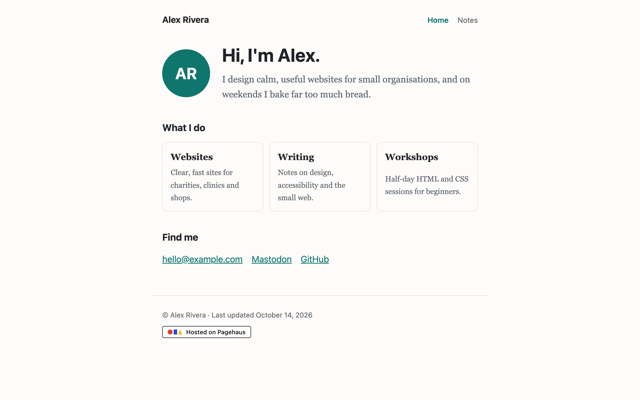
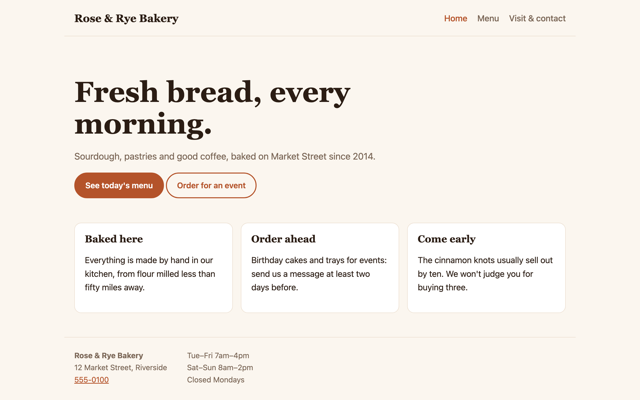
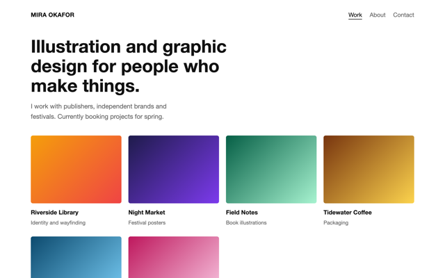
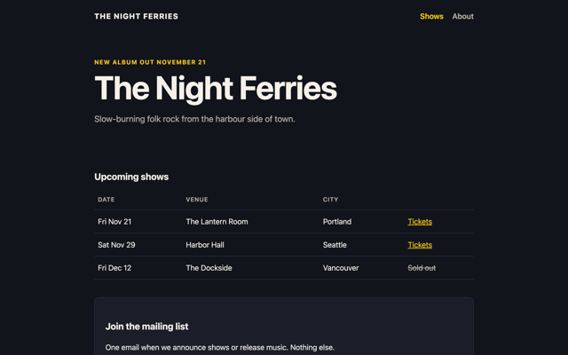
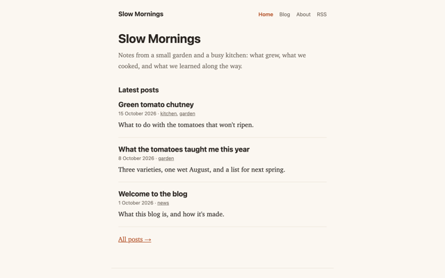
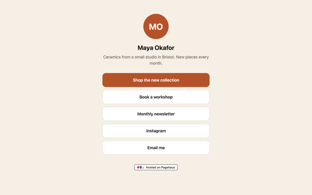

# Free HTML website templates

Six simple, fast website templates in plain HTML and CSS: no JavaScript framework, no build step, nothing to install.
Download one, change the words, and put it on any web host. Free for any use, including commercial ([MIT](LICENSE)).

They're the templates of [Pagehaus](https://pagehaus.app), plain HTML hosting, where you can also start a site from one
in a click and edit it in the browser.

| | Template | |
|---|---|---|
|  | **Personal page** A simple page about you: a short introduction, what you do, and where to find you. | [Preview](https://template-personal.pagehaus.site/) · [Files](plain/personal) |
|  | **Small business** A shop or café site: opening hours, a menu or price list, and a contact form. | [Preview](https://template-business.pagehaus.site/) · [Files](plain/business) |
|  | **Portfolio** Show your work: a grid of projects, an about page and a contact form for new clients. | [Preview](https://template-portfolio.pagehaus.site/) · [Files](plain/portfolio) |
|  | **Band or event** For a band, a festival or a club night: upcoming dates, an about page and a mailing-list sign-up. | [Preview](https://template-event.pagehaus.site/) · [Files](plain/event) |
|  | **Blog** A blog with posts, tags, an about page and an RSS feed. | [Preview](https://template-blog.pagehaus.site/) · [Files](plain/blog) |
|  | **Link in bio** One page with all your links, for your Instagram or TikTok bio: your photo, a line about you, and a button for each link. | [Preview](https://template-link-in-bio.pagehaus.site/) · [Files](plain/link-in-bio) |

## Two versions of each

- **[`plain/`](plain)**: ready to use anywhere. Open `index.html` in your browser to see it, then upload the folder to
  any host (GitHub Pages, Netlify, your own server). Every page is complete on its own.
- **[`ssi/`](ssi)**: the same site with its header and footer in one place, `includes/header.html` and
  `includes/footer.html`, shared by every page through [Server Side
  Includes](https://pagehaus.app/guides/same-header-footer-every-page). Change the menu once and every page follows.
  Needs a host that supports SSI: Pagehaus, or Apache with `Options +Includes`. Opened from disk, these pages show
  without their header and footer.

To get one template: download this repository (**Code → Download ZIP**) and keep the folder you want, or download a
single template from its page on [pagehaus.app/templates](https://pagehaus.app/templates).

## Learning HTML?

[`learn-html/`](learn-html) is the small site you build in [Learn HTML](https://pagehaus.app/learn/html), a free
course of eight short lessons, as it is at the end of the course. Compare it with yours as you go.

## Making it yours

- Replace the example text, names and links (search for `example.com`).
- Colours and fonts are at the top of each `style.css`, as CSS variables.
- The small "Template by Pagehaus" badge at the bottom is optional: delete it if you like (a comment marks it).
- **Contact and sign-up forms** send to `/_form/…`, which works on Pagehaus (messages are emailed to you). On another
  host, change the form's `action` to the address your form service gives you.
- **Blog**: on Pagehaus you write posts in Markdown and it makes the pages, tags and feed. Here the example posts are
  already made as HTML pages: copy one to write another, and update the list of posts, the tags and `blog/feed.xml`.

## Questions and ideas

Found a problem or want another kind of template? [Open an issue](../../issues). For Pagehaus itself, write to
support@pagehaus.app or visit [r/pagehaus](https://www.reddit.com/r/pagehaus/).

## How this repository is made

The files are exported from the templates Pagehaus uses, so the two never differ. In the Pagehaus repository:
`dotnet Pagehaus.Web.dll export-templates <this folder> https://pagehaus.app`.
